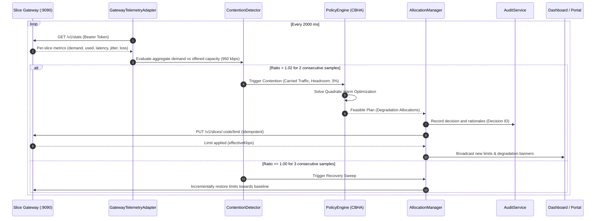

# System Architecture — CN Real Network Arbitration Testbed

This document details the architectural design, control plane sequencing, data plane shaping pipeline, telemetry subsystem, and operational protocols of the **5G CBHA Real-Network Arbitration Platform**.

---

## 1. High-Level Component Topology

The system separates concerns across six modular packages organized in an npm monorepo:

```
┌────────────────────────────────────────────────────────────────────────────────────────┐
│                              CONTROL PLANE (apps/controller)                           │
│                                                                                        │
│  ┌─────────────────────────┐  sample (2s)   ┌───────────────────────────────────────┐  │
│  │ GatewayTelemetryAdapter │ ◀───────────── │ Southbound Client (:9090)             │  │
│  └───────────┬─────────────┘                └───────────────────────────────────────┘  │
│              │                                                  ▲                      │
│              ▼                                                  │ apply limit          │
│  ┌─────────────────────────┐                ┌───────────────────┴───────────────────┐  │
│  │ Contention Detector     │ ──▶ CBHA ──▶   │ Allocation Manager (Two-Phase Apply)  │  │
│  │ (ratio > 1.02, 2 ticks) │     Solver     │ (Audit Log + Event Dispatch)          │  │
│  └─────────────────────────┘                └───────────────────────────────────────┘  │
└────────────────────────────────────────┬───────────────────────────────────────────────┘
                                         │ Southbound REST (127.0.0.1:9090, Bearer Auth)
                                         ▼
┌────────────────────────────────────────────────────────────────────────────────────────┐
│                               DATA PLANE (apps/gateway)                                │
│                                                                                        │
│  ┌──────────────────────────────────────────────────────────────────────────────────┐  │
│  │ Rate Limiter & Shaper Pipeline (20 ms tick, hrtime dt compensation)              │  │
│  │                                                                                  │  │
│  │  Slice 1 Queue (Clinic)   ──▶ Token Bucket ──┐                                   │  │
│  │  Slice 2 Queue (Factory)  ──▶ Token Bucket ──┤                                   │  │
│  │  Slice 3 Queue (Lab)      ──▶ Token Bucket ──┼──▶ [Root Bottleneck FIFO] ──▶ Rx  │  │
│  │  ...                                         │    (Offered Cap: 950 kbps)        │  │
│  │  Slice 7 Queue (Canteen)  ──▶ Token Bucket ──┘                                   │  │
│  └──────────────────────────────────────────────────────────────────────────────────┘  │
│                                         ▲                                              │
│                     ┌───────────────────┴───────────────────┐                          │
│                     │ Load Sessions (:8080) & Probes (:8080)│                          │
│                     └───────────────────────────────────────┘                          │
└────────────────────────────────────────┬───────────────────────────────────────────────┘
                                         │ Wi-Fi Hotspot (192.168.137.1) / Local LAN
                                         ▼
┌────────────────────────────────────────────────────────────────────────────────────────┐
│                              CLIENT PLANE (apps/portal & apps/agent)                   │
│                                                                                        │
│  📱 Phone 1 (Clinic)     💻 Laptop (Quality Lab)      📱 Phone 7 (Canteen)             │
│     Slice Portal :8080       Headless Agent (CLI)         Slice Portal :8080           │
│     Active Prober (1s)       Active Prober (1s)           Active Prober (1s)           │
│     Demand Generator         Demand Generator             Demand Generator             │
└────────────────────────────────────────────────────────────────────────────────────────┘
```

---

## 2. Monorepo Structure

| Package / Application | Directory | Purpose | Technology Stack |
|---|---|---|---|
| `@cn/controller` | `apps/controller` | Control plane: policy engine, contention detection, CBHA arbitration, two-phase apply, audit trail, OpenAPI. | Node.js 24, TypeScript, Express, Zod, Pino |
| `@cn/gateway` | `apps/gateway` | Data plane: per-slice token bucket shaping, load streaming, active probe queuing, HTTP forward proxy, southbound server. | Node.js 24, TypeScript, `node:http`, `ws`, Zod |
| `@cn/portal` | `apps/portal` | Department user interface: join code authentication, demand slider/presets, live charts, SLA chips, degradation alerts. | React 18, Vite 5, TypeScript, Tailwind CSS, Recharts |
| `@cn/dashboard` | `apps/dashboard` | Operator console: interactive SVG topology map, QR code drawer, device manager, scenario runner, CSV recorder. | React 18, Vite 5, TypeScript, Tailwind CSS, Recharts |
| `@cn/agent` | `apps/agent` | Headless slice client: CLI and standalone `.exe` for automated testbed generation and multi-machine testing. | Node.js 24, TypeScript, Node Single Executable Application |
| `@cn/shared` | `packages/shared` | Shared contracts: Zod schemas, TypeScript interfaces, error types, bandwidth formatters (`formatBandwidth`). | TypeScript, Zod |

---

## 3. Port Map and Network Security

| Port | Bind Address | Exposure | Protocol / Role |
|---|---|---|---|
| **4000** | `0.0.0.0` | Local Subnet | **Controller API & Dashboard:** REST endpoints, Socket.IO updates, OpenAPI spec, production static asset server. |
| **5173** | `127.0.0.1` | Localhost | **Dashboard Dev Server:** Vite development server with hot-module reloading. |
| **8080** | `0.0.0.0` | Local Subnet | **Slice Gateway:** Portal static files, `/portal-api/*`, `/load/down`, `/probe`, and WebSocket `/ws`. |
| **8888** | `0.0.0.0` | Local Subnet | **HTTP Forward Proxy:** Transparent forward proxy with HTTP `CONNECT` tunneling for real mobile applications. |
| **9090** | **`127.0.0.1` only** | **Loopback Only** | **Southbound API:** Secure control interface between controller and gateway. Protected by Bearer token. |

> **Security Guardrail:** Port 9090 is strictly bound to `127.0.0.1`. Client devices on the Wi-Fi hotspot or local subnet cannot reach or tamper with the southbound control API.

---

## 4. The Closed-Loop Arbitration Lifecycle

Every 2 seconds, the platform executes an end-to-end feedback loop:



### 1. Sampling (`GatewayTelemetryAdapter`)
- Calls `GET /v1/stats` on the gateway Southbound API.
- Converts rates from `kbps` to `Mbps` using the scale factor $s = 0.1$ ($1 \text{ unit} = 1 \text{ kbps}$).
- If the gateway is unreachable or missing data for a slice, marks health as `UNKNOWN`, preventing dangerous arbitration on stale metrics.

### 2. Contention Detection (`ContentionDetector`)
- Calculates aggregate demand ratio:
  $$\text{Ratio} = \frac{\sum \text{Carried Demand}}{\text{Offered Capacity} = 950\text{ kbps}}$$
- Contention opens if $\text{Ratio} \ge 1.02$ for **2 consecutive ticks** (hysteresis prevents flapping on transient spikes).

### 3. CBHA Optimization (`PolicyEngine`)
- Runs the immutable Context-Based Harm Arbitration solver copied from SOURCE.
- Solves for the minimal business harm vector across the 7 departments subject to:
  1. $\sum \text{Allocated Bandwidth} \le \text{Offered Capacity} \times (1 - \text{Headroom Target} = 0.03) \approx 921.5\text{ kbps}$.
  2. $\text{Allocated}_i \ge \text{Floor}_i$ (Contractual minimum guaranteed rate).
  3. $\text{Degradation}_i \le \text{Ceiling}_i$ (Max allowed degradation percentage).
  4. Clinic effective degradation ceiling is **0%** (Life-Safety exemption).

### 4. Two-Phase Apply & Audit
- Saves decision record in the immutable audit log with full explanation text.
- Sends idempotent `PUT /v1/slices/:code/limit` to the gateway.
- Southbound updates take effect within a single 20 ms scheduler tick.

### 5. Recovery Sweep
- When aggregate demand falls below capacity for **3 clear samples**, recovery begins.
- Step-wise increments restore degraded slices towards baseline allocations at a rate governed by cooldown tunables.

---

## 5. Shaper Data Plane Architecture

The data plane in `apps/gateway` models a carrier-grade edge gateway / slice-aware User Plane Function (UPF):

```
Client Traffic In ──▶ [Slice Ingress Filter]
                             │
                             ├──▶ Slice Queue 1 (Capacity: 0.5s × Baseline) ──▶ Token Bucket 1 ──┐
                             ├──▶ Slice Queue 2 (Capacity: 0.5s × Baseline) ──▶ Token Bucket 2 ──┤
                             │    ...                                                            ├──▶ [Root Shared Queue] ──▶ Sockets Out
                             └──▶ Slice Queue 7 (Capacity: 0.5s × Baseline) ──▶ Token Bucket 7 ──┘    (950 kbps Cap)
                                  (Over-rate → Slice Tail Drop)                                       (Over-rate → Root Tail Drop)
```

### High-Resolution Tick Scheduling
Windows default timer resolution (~15.6 ms) introduces scheduling jitter. The shaper overcomes this by computing actual elapsed high-resolution time on every tick:

```typescript
const nowNs = process.hrtime.bigint();
const dtSeconds = Number(nowNs - this.lastTickNs) / 1e9;
this.lastTickNs = nowNs;
```

### Token Bucket Logic
On each tick ($dt$ seconds):
1. **Refill Slice Buckets:**
   $$\text{Tokens}_i = \min\left(\text{Tokens}_i + \text{LimitBps}_i \times \frac{dt}{8}, \text{BurstBytes}_i\right)$$
2. **Refill Root Bucket:**
   $$\text{RootTokens} = \min\left(\text{RootTokens} + \text{OfferedBps} \times \frac{dt}{8}, \text{RootBurstBytes}\right)$$
3. **Police (Round-Robin):** Move up to 1 KB chunks from `sliceQueue_i` to `rootQueue` while $\text{Tokens}_i$ allow. If `rootQueue` is full, tail-drop occurs and increments `rootDropped_i`.
4. **Transmit:** Drain `rootQueue` in FIFO order while `RootTokens` allow. Write chunks to client sockets. If `socket.write()` returns `false`, pause session until `'drain'`.

---

## 6. Active Probe & SLA Engine

Probe measurements represent the ground-truth experience of each slice:

1. **In-Band Measurement:** Clients send `GET /probe?device=<id>&seq=<n>` every 500 ms. The gateway injects a 64-byte probe payload directly into **that slice's FIFO queue**. If the slice is congested, the probe sits behind data packets, experiencing true queueing delay.
2. **RFC 3550 Jitter Computation:**
   $$D(i, j) = (R_j - S_j) - (R_i - S_i)$$
   $$J(i) = J(i - 1) + \frac{|D(i, j)| - J(i - 1)}{16}$$
3. **Loss Accounting:**
   $$\text{Loss } \% = \max\left(\frac{\text{Dropped Bytes}}{\text{Offered Bytes}}, \frac{\text{Lost Probes}}{\text{Sent Probes}}\right) \times 100$$
4. **Availability:** Rolling 5-minute ratio of answered probes to dispatched probes.
5. **No Made-Up Numbers:** If a slice has no active devices sending probes, metrics report `null` / `UNKNOWN`. The dashboard displays `—`.

---

## 7. Zero-Dependency & Sandboxed Windows Adaptations

To comply with strict environment constraints (Windows 11, Node 24, zero native add-ons, sandbox execution):
- **Pure-TS QR Code Engine (`src/lib/qrcode.ts`):** Zero-dependency QR code generator rendering UTF-8 terminal blocks and SVG vector graphics without canvas or native bindings.
- **Node 24 Sandboxed Realpath Preload (`scripts/patch-realpath.cjs`):** Transparently patches `fs.realpathSync.native` to `fs.realpathSync`, circumventing Windows security sandbox `EPERM` limitations.
- **Dynamic Adapter Introspection:** Dynamically probes `os.networkInterfaces()` for hosted networks, Mobile Hotspot aliases, and local LAN adapters at runtime, eliminating hard-coded IP dependencies.
